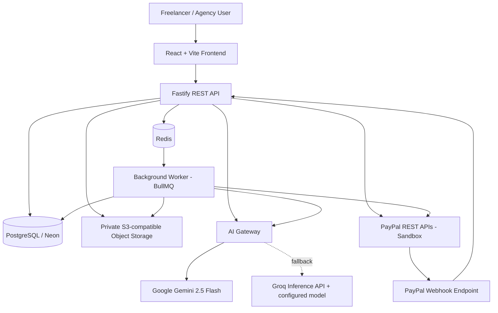
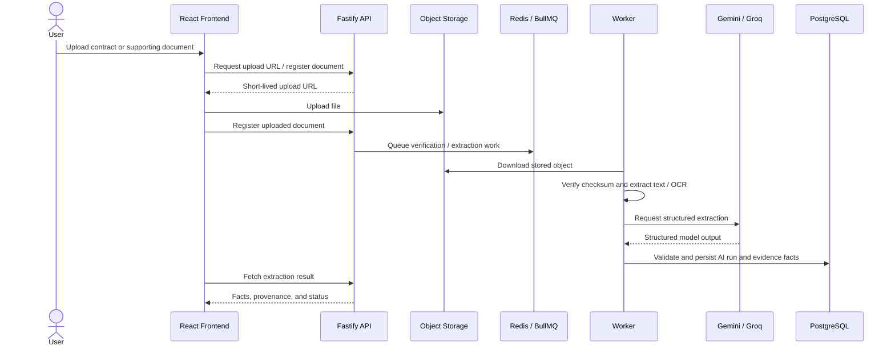
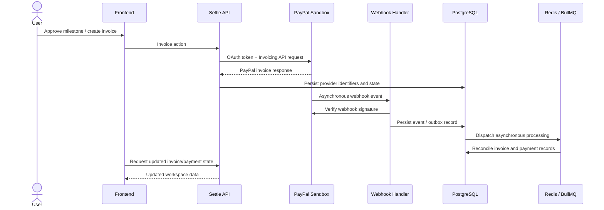
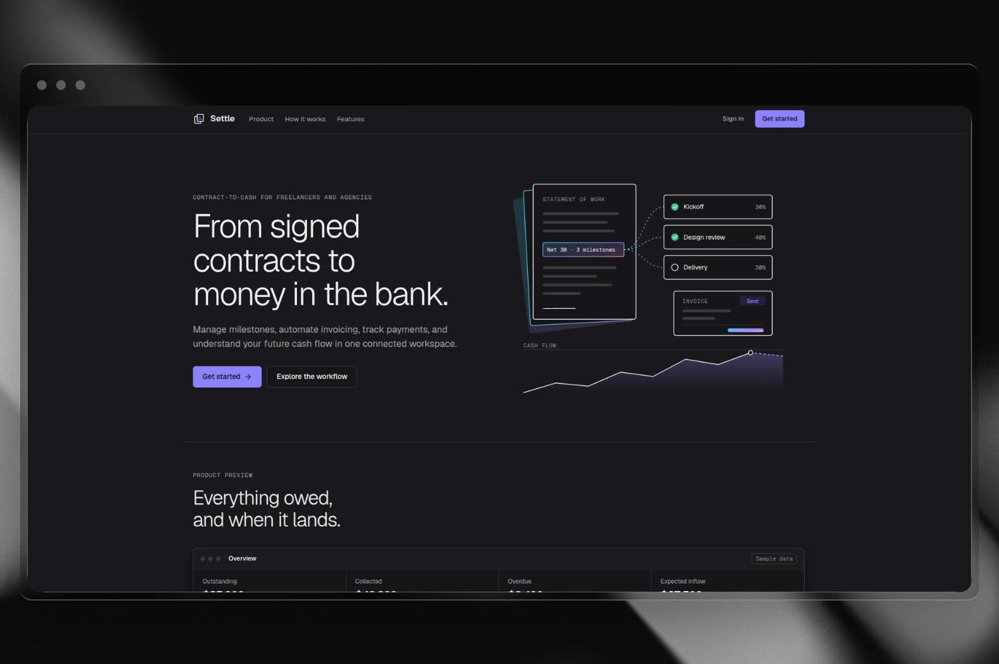
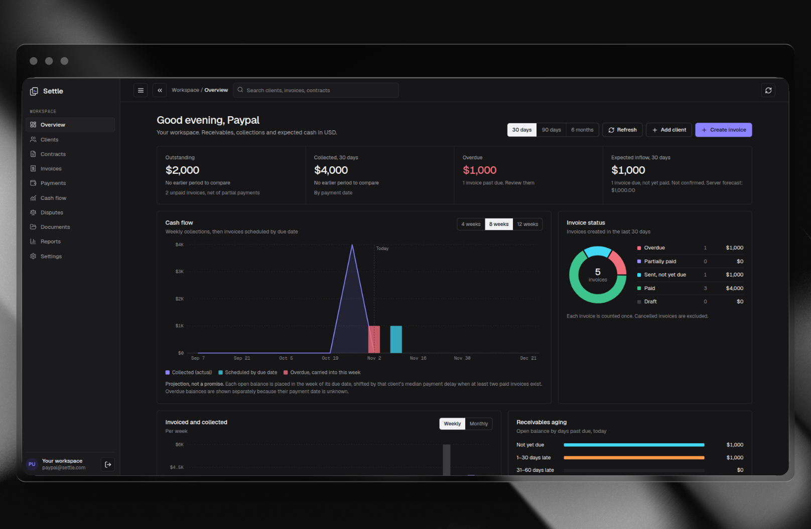
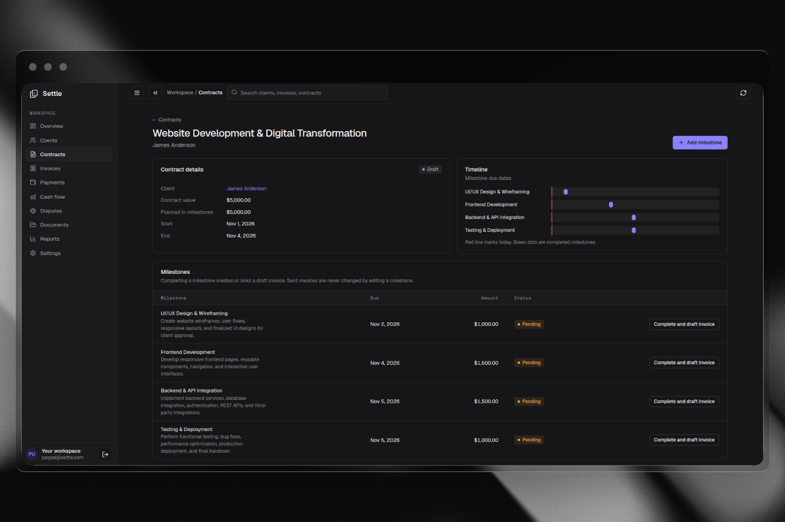
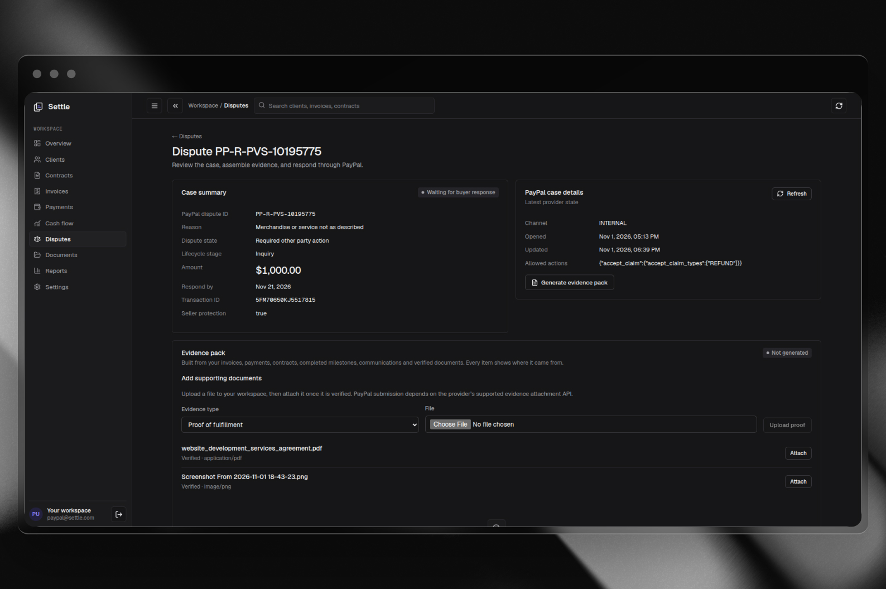
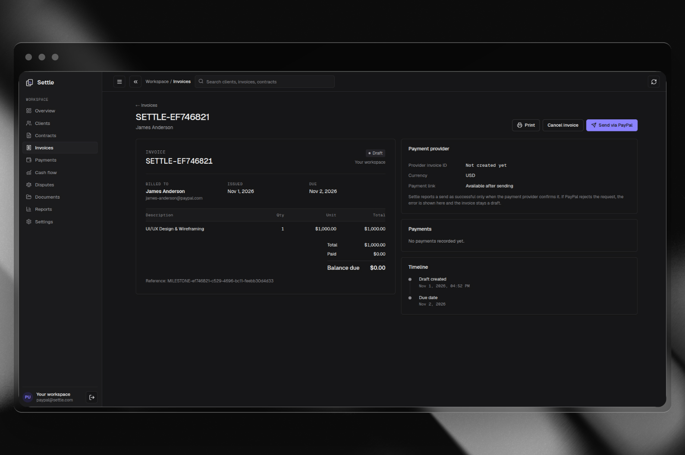
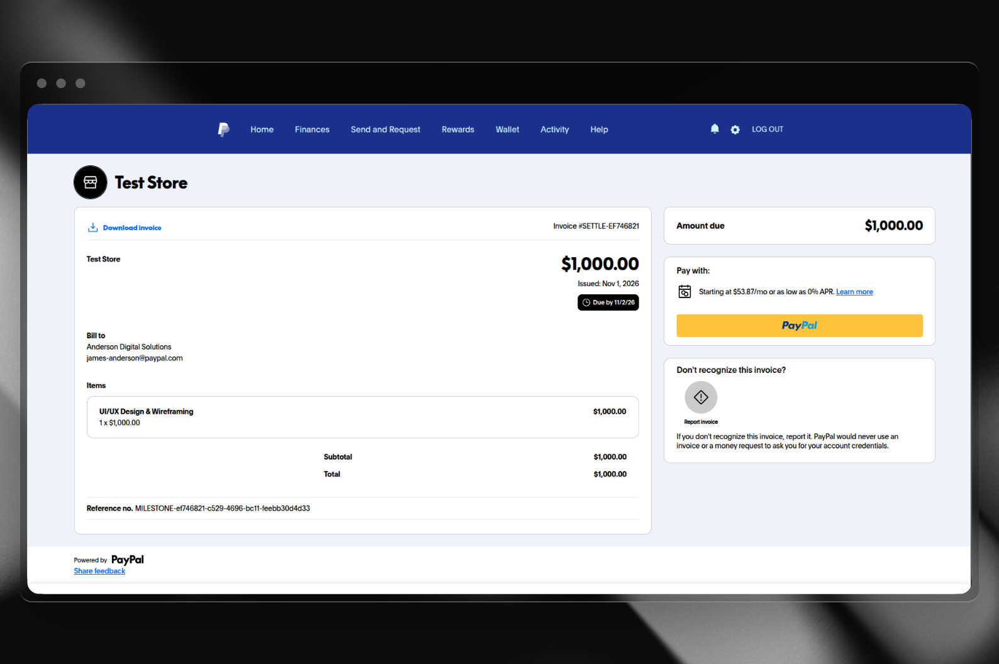
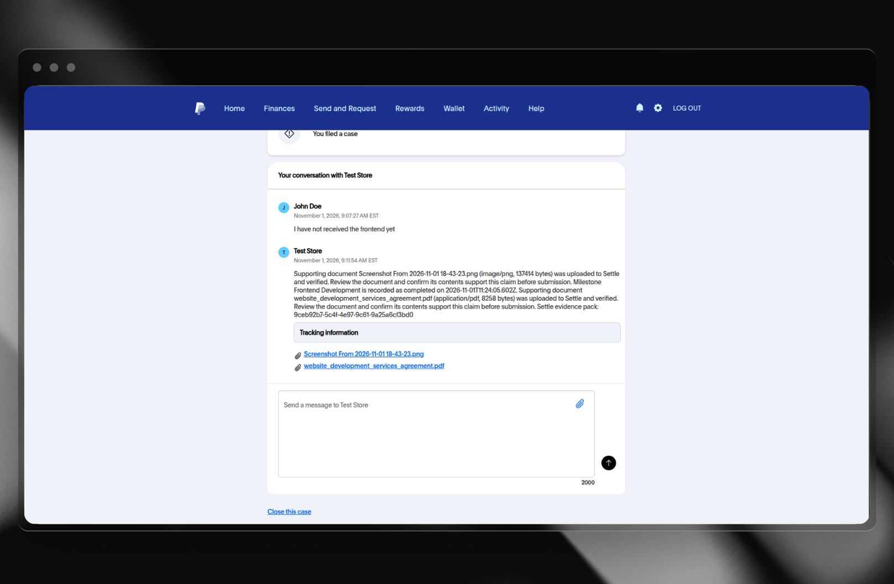

# Settle — AI-Powered Contract-to-Cash Platform

> Contract intelligence, milestone execution, PayPal invoicing, and payment operations in one workspace.

Settle is a full-stack SaaS application designed around a workspace-scoped contract-to-cash workflow. This repository documents the application architecture, integration boundaries, local development environment, and deployment configuration.

Settle is a contract-to-cash workspace for freelancers and agencies. It helps turn contract and Statement of Work (SOW) information into an operational payment workflow: organize clients and contracts, manage milestones, issue PayPal invoices, synchronize payment events, monitor disputes, and prepare supporting evidence.

**Project version:** `0.16.1`
**Deployment:** Render (frontend and API)
**Payment integration:** PayPal Developer Platform — Sandbox
**AI:** Google Gemini 2.5 Flash (primary) with a configurable Groq-hosted fallback model
**Status:** Hackathon / demonstration project. Use the PayPal Sandbox for demonstrations; do not treat this repository as a production financial, legal, or accounting system without a separate security and compliance review.

---

## Contents

- [Product overview](#product-overview)
- [Problem and solution](#problem-and-solution)
- [Core capabilities](#core-capabilities)
- [Application architecture](#application-architecture)
- [Technology stack](#technology-stack)
- [PayPal Developer Platform integration](#paypal-developer-platform-integration)
- [AI integration](#ai-integration)
- [Data, background jobs, and reliability](#data-background-jobs-and-reliability)
- [Screenshots](#screenshots)
- [Live deployment](#live-deployment)
- [Repository structure](#repository-structure)
- [Prerequisites](#prerequisites)
- [Local setup](#local-setup)
- [Environment variables](#environment-variables)
- [Database and migrations](#database-and-migrations)
- [Run the application](#run-the-application)
- [PayPal Sandbox setup](#paypal-sandbox-setup)
- [AI provider setup](#ai-provider-setup)
- [Document storage setup](#document-storage-setup)
- [Testing and quality checks](#testing-and-quality-checks)
- [Deployment on Render](#deployment-on-render)
- [Security and privacy notes](#security-and-privacy-notes)
- [Known limitations and scope](#known-limitations-and-scope)
- [Troubleshooting](#troubleshooting)
- [Contributing](#contributing)
- [License](#license)

---

## Product overview

Freelancers and agencies often manage a client's contract, delivery milestones, invoices, payment follow-ups, and disputes across disconnected tools. Important dates and payment obligations can be buried in long contracts, while invoice and dispute status needs repeated manual checking.

Settle brings these workflows into one workspace. Its AI-assisted document pipeline helps extract relevant contract facts, while PayPal provides the invoicing and payment-related integration. The freelancer remains in control: extracted information can be reviewed before it is used in the workflow, and AI-generated dispute analysis is presented for review rather than being treated as an automatic legal decision.

## Problem and solution

### The problem

- Contract terms and payment conditions are often unstructured and difficult to operationalize.
- Milestones, due dates, and invoice amounts can be tracked manually in spreadsheets.
- Invoice creation and payment-status updates are disconnected from contract delivery.
- Late payments require repeated follow-ups.
- Disputes require collecting transaction details and supporting documents from multiple places.

### The Settle approach

1. Store clients, contracts, and supporting documents in a workspace.
2. Extract contract facts from verified documents with an AI-assisted pipeline.
3. Review the extracted facts and organize work into milestones.
4. Create and send invoices through PayPal.
5. Synchronize relevant PayPal events and reconcile invoice/payment state.
6. Monitor disputes and assemble evidence for human review.
7. View invoice, payment, and cash-flow information in one dashboard.

---

## Core capabilities

Capabilities represented in the current repository include:

- **Workspace-based access:** users, workspaces, and workspace memberships.
- **Client management:** create and edit workspace clients.
- **Contract management:** create and view contracts and their milestones.
- **Document management:** workspace-scoped document upload and verification using object storage.
- **AI document extraction:** asynchronous extraction of structured contract facts from supported documents.
- **Milestone billing:** create invoices from approved milestone/payment information.
- **Invoice management:** create, send, remind, cancel, and view invoices through the application workflow.
- **Payment tracking:** store payment records and reconcile provider events.
- **PayPal connection settings:** store PayPal app credentials for a workspace in encrypted form.
- **PayPal dispute synchronization:** retrieve and synchronize dispute records.
- **Evidence packs:** collect deterministic evidence, generate AI-assisted analysis, require review, and submit evidence through the PayPal adapter where supported.
- **Cash-flow views:** summarize invoice and payment information and provide a rule-based forecast.
- **Background processing:** Redis/BullMQ workers for asynchronous tasks and reminders.
- **Operational safeguards:** audit records, idempotency support, transactional outbox processing, rate limiting, and workspace scoping.

Feature availability depends on the configured external services and credentials. See [Known limitations and scope](#known-limitations-and-scope).

---

## Application architecture

The application is organized as a TypeScript Fastify API and a React/Vite single-page frontend. PostgreSQL stores application data. Redis supports queues, locks, and provider rate limits. A separate worker process handles asynchronous jobs.

### High-level architecture



### Main request and processing flows

**Contract/document AI flow**



**PayPal invoice and webhook flow**



---

## Technology stack

The following technologies are visible in the repository or its configuration.

| Area | Technology | Role |
|---|---|---|
| Frontend | React 19 | User interface |
| Frontend tooling | Vite 6 | Development server and production bundling |
| Routing | React Router 7 | URL-based application routes |
| Charts | Recharts | Dashboard and financial visualizations |
| Backend | Node.js + TypeScript | Runtime and application language |
| API framework | Fastify 5 | REST API, plugins, and request handling |
| Validation | Zod 4 | Request and AI-output validation |
| Database | PostgreSQL | Persistent application data |
| Database hosting | Neon (supported deployment option) | Managed PostgreSQL |
| ORM / migrations | Drizzle ORM + Drizzle Kit | Typed queries and schema migrations |
| Queue | BullMQ | Asynchronous jobs |
| Queue / lock store | Redis + ioredis | Job coordination, locks, and rate limits |
| Authentication | JWT (`jose`) | Short-lived access tokens |
| Password hashing | Node.js `scrypt` | Password hashing |
| Object storage | Backblaze B2 S3-compatible API or AWS S3-compatible configuration | Private document storage |
| PDF text extraction | Poppler `pdftotext` | Extract text from PDFs |
| Image OCR | Tesseract OCR | Extract text from supported images |
| Payment platform | PayPal Developer Platform | Sandbox invoicing, disputes, reporting, and webhooks |
| Primary AI | Google Gemini 2.5 Flash | Contract and evidence analysis |
| Fallback inference provider | Groq | OpenAI-compatible fallback inference |
| Logging | Pino (through Fastify logging) | Structured application logs |
| Tests | Vitest | Backend tests |
| Deployment | Render | Hosting for frontend/API and, when configured, worker services |

The repository does not currently show an Elasticsearch integration. Search-related UI functionality should not be described as Elasticsearch-powered.

---

## PayPal Developer Platform integration

Settle integrates with the **PayPal Developer Platform using the free PayPal Sandbox environment**. Sandbox credentials and test accounts allow the payment workflow to be demonstrated without moving real money.

### PayPal tools and APIs

| PayPal tool / API | How Settle uses it |
|---|---|
| **PayPal Developer Dashboard** | Create Sandbox business and personal test accounts, create REST applications, obtain Client ID and Secret, and configure webhook subscriptions. |
| **PayPal REST API** | Base API surface used by Settle's PayPal adapters. |
| **PayPal OAuth 2.0** | Uses the Client Credentials flow (`/v1/oauth2/token`) to obtain access tokens for server-to-server PayPal API requests. |
| **PayPal Invoicing API** | Creates, retrieves, searches, sends, reminds, and cancels invoices using PayPal's v2 invoicing endpoints. |
| **PayPal Webhooks** | Receives asynchronous provider events. Settle verifies webhook signatures through PayPal's webhook verification endpoint before accepting events for processing. |
| **PayPal Disputes API** | Lists disputes, retrieves dispute details, and supports evidence submission through the dispute adapter. |
| **PayPal Reporting API** | Retrieves transaction reporting data using the Reporting Transactions endpoint. |

### Workspace-scoped PayPal connections

Settle supports connecting a PayPal REST application to an individual workspace. Each workspace connection stores its own environment and encrypted application credentials. Client IDs and Client Secrets are encrypted at rest using **AES-256-GCM**, with the encryption key supplied through `PAYPAL_CREDENTIALS_ENCRYPTION_KEY`.

When an authenticated workspace performs supported PayPal operations, the backend resolves that workspace's connected PayPal account, decrypts its credentials in the server process, and creates a PayPal client for the configured environment. Invoice operations, dispute operations, reporting requests, evidence submission, and webhook reconciliation use the workspace connection flow implemented in the corresponding modules.

The browser never receives the PayPal Client Secret. For the project demonstration, connect Sandbox applications and use the Sandbox environment. The PayPal base URL is selected from the workspace connection's environment setting.


### PayPal invoice lifecycle

1. A freelancer creates or approves a contract milestone.
2. Settle prepares invoice data from the milestone and client information.
3. The backend obtains a PayPal OAuth access token.
4. The backend creates the invoice through PayPal Invoicing API.
5. The invoice can be sent, reminded, or cancelled through the invoice workflow.
6. PayPal returns provider identifiers and invoice details.
7. Webhook events are signature-verified and processed to synchronize relevant state.

The invoice adapter supplies PayPal request identifiers for supported idempotent create operations.

### PayPal dispute and evidence workflow

1. Settle synchronizes dispute records from PayPal.
2. It gathers available transaction and document evidence.
3. The AI pipeline can analyze the evidence and produce a draft/structured assessment.
4. The evidence pack is marked for review.
5. An authorized owner/admin reviews and approves it.
6. The PayPal adapter submits the approved evidence where the provider API supports the request.

**AI does not independently make a final legal determination or submit an evidence response without the application's review/approval step.**

### Sandbox configuration

Use the following base URL:

```text
https://api-m.sandbox.paypal.com
```

Do not use real PayPal credentials in a public repository. Do not commit Sandbox secrets either.

---

## AI integration

Settle uses a provider-configurable AI gateway for document extraction and dispute/evidence analysis.

### AI tools and models

**Google Gemini 2.5 Flash — primary model**

- Configured through `AI_PROVIDER=gemini`.
- Default model configured in the backend is `gemini-2.5-flash`.
- Used for structured analysis of extracted contract/document text.
- The Gemini API is called using its `generateContent` endpoint with JSON response mode.
- Model output is parsed and validated against application schemas before it is persisted or used by downstream workflows.

**Groq — fallback inference platform**

- Configured using `AI_FALLBACK_PROVIDER=groq`.
- Groq exposes an OpenAI-compatible chat completions API.
- Settle uses the configured `AI_FALLBACK_MODEL` value rather than hard-coding a model ID.
- The fallback model is the OpenAI 120B model configured in the deployment environment, as selected by the project developer.

> Model naming: Groq is the inference provider, not the model. The exact model identifier must match the value configured in `AI_FALLBACK_MODEL`. Add that exact identifier here before publishing the repository. Do not label it as an OpenAI-hosted API call if the request is sent to Groq.

### AI failover behavior

The AI gateway first attempts the configured primary provider. It attempts the configured fallback provider only for eligible temporary failures, including rate limits, provider server errors, timeouts/network failures, and a primary model/endpoint `404`.

Authentication errors and malformed requests are not silently masked by fallback. Invalid model output is validated and rejected rather than being blindly trusted.

The AI gateway also includes:

- Provider-specific Redis-backed rate limiting.
- Configurable request timeout.
- Input and output size limits.
- JSON parsing and Zod schema validation.
- Provider/model/latency/token metadata for AI runs where returned by the provider.
- Asynchronous job processing and retries through BullMQ.
- Redis locking and successful extraction reuse keyed by document/workspace/prompt/content information.

### What AI does in Settle

- Extracts contract facts from supported documents.
- Structures client, milestone, amount, due-date, and payment-term information where present in the source.
- Helps analyze dispute evidence and draft supporting claims.
- Identifies missing evidence for human review.
- Returns structured output that the backend validates before persistence.

AI output can be incorrect or incomplete. Users should review extracted terms and evidence drafts before taking financial or dispute-related actions.

---

## Data, background jobs, and reliability

### PostgreSQL

PostgreSQL stores the core application records, including users, workspaces, memberships, clients, contracts, milestones, invoices, payments, documents, disputes, AI runs, evidence facts, refresh tokens, and PayPal connection information.

### Redis and BullMQ

Redis supports background job processing and coordination. The worker handles asynchronous tasks such as document verification/extraction, outbox dispatch, reminders, and other queued work.

Run the API and worker as separate processes. In a hosted environment, they can be separate Render services using the same backend repository and compatible environment variables.

### Reliability mechanisms present in the codebase

- Workspace-scoped data access in application services.
- Idempotency support for relevant write operations.
- Transactional outbox pattern for durable event dispatch.
- Redis distributed locks for selected jobs.
- BullMQ retries and backoff for asynchronous processing.
- Provider-aware AI rate limits and retry behavior.
- PayPal OAuth token caching and bounded retry behavior for safe requests.
- Audit logging and structured API logging.
- Document checksum validation and asynchronous verification.

---

## Screenshots

Add high-resolution screenshots in `docs/screenshots/`. The image references below define the expected filenames; add the corresponding image files to make them render on GitHub.

Suggested directory:

```text
docs/
└── screenshots/
    ├── 01-landing-page.png
    ├── 02-login.png
    ├── 03-dashboard-overview.png
    ├── 04-contract-list.png
    ├── 05-contract-details.png
    ├── 06-ai-contract-extraction.png
    ├── 07-milestone-management.png
    ├── 08-invoice-details.png
    ├── 09-paypal-invoice.png
    ├── 10-payments.png
    ├── 11-cashflow.png
    ├── 12-disputes.png
    ├── 13-evidence-review.png
    ├── 14-document-management.png
    └── 15-workspace-settings.png
```

### 1. Landing page

<!-- SCREENSHOT: Add docs/screenshots/01-landing-page.png -->


### 2. Dashboard overview

<!-- SCREENSHOT: Add docs/screenshots/03-dashboard-overview.png -->


### 3. Contract details and milestones

<!-- SCREENSHOT: Add docs/screenshots/05-contract-details.png -->


### 4. AI contract extraction

<!-- SCREENSHOT: Add docs/screenshots/06-ai-contract-extraction.png -->


### 5. Invoice and PayPal integration

<!-- SCREENSHOT: Add docs/screenshots/08-invoice-details.png -->


### 6. Payments and cash flow

<!-- SCREENSHOT: Add docs/screenshots/10-payments.png -->


### 7. Disputes and evidence review

<!-- SCREENSHOT: Add docs/screenshots/13-evidence-review.png -->


### Screenshot guidance

- Capture the real running application; do not use mockups that imply an unimplemented feature.
- Use consistent browser zoom and window dimensions.
- Use realistic but fictitious client names and payment details.
- Blur or remove email addresses, account IDs, transaction IDs, access tokens, and other personal or secret data.
- Never show PayPal Client Secrets, API keys, JWT secrets, database URLs, or webhook secrets.
- Prefer PNG for UI screenshots. Optimize image size while preserving readable text.
- Add screenshots only for screens/features available in the submitted version.

---

## Live deployment

Settle is deployed using Render.

- **Frontend:** https://settle-c05x.onrender.com/
- **Backend API:** https://settle-api-77im.onrender.com/

The frontend communicates with the backend using the configured API base URL. The backend uses CORS to allow the deployed frontend origin.

Useful API health endpoints:

```text
https://settle-api-77im.onrender.com/health
https://settle-api-77im.onrender.com/health/ready
```

If the deployment URLs change, update this section.

### Render services

A typical deployment uses:

1. **Frontend Web Service:** builds the Vite frontend and serves the generated `frontend/dist` directory using a static-site service or configured web server.
2. **Backend Web Service:** runs the Fastify API and exposes the REST and webhook endpoints.
3. **Worker Service:** runs the BullMQ worker process using the backend codebase.
4. **Managed dependencies:** PostgreSQL, Redis, and object storage are provisioned separately and connected through environment variables.

The repository archive does not include a Render Blueprint (`render.yaml`). Configure the services in the Render Dashboard or add a Blueprint after validating the exact build/start commands for the selected service types.

---

## Repository structure

```text
settle-v1.6.0/
├── frontend/                  # React + Vite application
│   ├── src/
│   │   ├── components/        # Shared UI components and application shell
│   │   ├── features/          # Auth, dashboard, clients, contracts, invoices, etc.
│   │   ├── services/          # Frontend API client and session handling
│   │   ├── lib/               # Formatting, analytics, upload helpers
│   │   └── styles/            # Design tokens and application styles
│   ├── package.json
│   └── README.md
├── src/
│   ├── config/                # Environment configuration
│   ├── db/                    # Drizzle database client and schema
│   ├── lib/                   # Redis, queues, logging, audit, idempotency, etc.
│   ├── modules/
│   │   ├── ai/                # AI provider gateway, extraction, AI routes
│   │   ├── auth/              # Authentication and refresh-token lifecycle
│   │   ├── documents/         # Document upload and verification
│   │   ├── disputes/          # Dispute and evidence workflows
│   │   ├── invoices/          # Invoice workflows
│   │   └── paypal/            # PayPal API adapters and connection routes
│   ├── workers/               # BullMQ worker entry points
│   └── server.ts              # Fastify application entry point
├── drizzle/                   # SQL migrations and Drizzle metadata
├── tests/                     # Backend tests
├── docs/                      # Add architecture notes and screenshots here
├── .env.example               # Environment variable template
├── Dockerfile
├── docker-compose.yml
├── package.json
└── README.md
```

---

## Prerequisites

- Node.js 22 or newer (the repository was developed with a modern Node.js runtime).
- npm.
- PostgreSQL 15+ or a compatible managed PostgreSQL service such as Neon.
- Redis 6+ or a compatible managed Redis service.
- PayPal Developer account with Sandbox REST application credentials.
- Google AI Studio / Gemini API key.
- Groq API key if fallback inference is enabled.
- S3-compatible object storage credentials for document upload features.
- Poppler (`pdftotext`) for PDF text extraction.
- Tesseract OCR and English language data for image OCR.

---

## Local setup

### 1. Clone the repository

```bash
git clone https://github.com/<YOUR_GITHUB_USERNAME>/<YOUR_REPOSITORY>.git
cd <YOUR_REPOSITORY>
```

Replace the repository URL with the public repository URL.

### 2. Install backend dependencies

```bash
npm ci
```

### 3. Install frontend dependencies

```bash
npm ci --prefix frontend
```

### 4. Configure environment variables

```bash
cp .env.example .env
```

Edit `.env` and provide the required values. See [Environment variables](#environment-variables).

### 5. Prepare PostgreSQL and Redis

Create a development PostgreSQL database and a Redis instance. Use separate development/test resources; do not point local tests or migrations at production.

### 6. Apply database migrations

For a database with the repository's migration history:

```bash
npm run db:migrate
```

The repository also defines `db:push`, but migrations are the preferred reproducible schema workflow. Do not run fresh-database or destructive SQL against an existing production database.

### 7. Build the backend

```bash
npm run build
```

### 8. Build the frontend

```bash
npm run frontend:build
```

---

## Environment variables

Copy `.env.example` to `.env`. The following table describes the main variables. Values must be supplied through your local environment or hosting provider; never commit real secrets.

| Variable | Purpose | Required |
|---|---|---|
| `NODE_ENV` | Runtime environment: `development`, `test`, or `production` | Yes |
| `PORT` | API listening port; defaults to `4000` | Optional |
| `HOST` | API bind address; use `0.0.0.0` in containers/Render | Optional |
| `LOG_LEVEL` | Pino/Fastify log level | Optional |
| `DATABASE_URL` | PostgreSQL connection string | Yes |
| `REDIS_URL` | Redis connection string used by BullMQ and coordination | Yes |
| `CORS_ORIGIN` | Exact frontend origin allowed by the API | Yes in production |
| `AUTH_JWT_SECRET` | Strong secret used to sign access JWTs; at least 32 characters | Yes in production |
| `ACCESS_TOKEN_TTL_SECONDS` | Access token lifetime; default `900` seconds | Optional |
| `REFRESH_TOKEN_TTL_DAYS` | Refresh-token lifetime; default `30` days | Optional |
| `PAYPAL_BASE_URL` | Global PayPal API base URL; Sandbox default is `https://api-m.sandbox.paypal.com` | Depends on PayPal mode |
| `PAYPAL_CLIENT_ID` | Global PayPal REST app Client ID used by the global PayPal client | Depends on adapter/configuration |
| `PAYPAL_CLIENT_SECRET` | Global PayPal REST app Secret | Depends on adapter/configuration |
| `PAYPAL_WEBHOOK_ID` | Webhook ID used for PayPal signature verification | Required for webhook verification |
| `PAYPAL_ALLOW_SANDBOX_IN_PRODUCTION` | Explicitly permits Sandbox base URL in production; set `true` only for a Sandbox demo | Required for production Sandbox demo |
| `PAYPAL_CREDENTIALS_ENCRYPTION_KEY` | Exactly 32 UTF-8 bytes; encrypts workspace PayPal credentials | Yes in production |
| `AI_ENABLED` | Enables/disables AI processing | Optional; default false |
| `AI_PROVIDER` | Primary provider: `gemini`, `openai`, or `groq` | Optional |
| `AI_API_KEY` | Primary provider API key | Required when AI is enabled |
| `AI_MODEL` | Primary model ID; default `gemini-2.5-flash` | Optional |
| `AI_BASE_URL` | Optional custom primary provider base URL | Optional |
| `AI_FALLBACK_PROVIDER` | Fallback provider: `none`, `groq`, or `openai` | Optional |
| `AI_FALLBACK_API_KEY` | Fallback provider API key | Required when fallback is enabled |
| `AI_FALLBACK_MODEL` | Exact fallback model ID enabled for your provider account | Required when fallback is enabled |
| `AI_FALLBACK_BASE_URL` | Optional custom fallback base URL | Optional |
| `AI_TIMEOUT_MS` | Provider request timeout; default `45000` | Optional |
| `AI_MAX_INPUT_CHARS` | Maximum AI input characters | Optional |
| `AI_MAX_OUTPUT_TOKENS` | Maximum model output tokens | Optional |
| `AI_RATE_LIMIT_MAX` | Per-provider request limit per window | Optional |
| `AI_RATE_LIMIT_WINDOW_MS` | AI rate-limit window in milliseconds | Optional |
| `B2_ENDPOINT` | Backblaze B2 S3-compatible endpoint | Required for B2 |
| `B2_REGION` | B2 region | Required for B2 |
| `B2_BUCKET` | B2 bucket name | Required for B2 |
| `B2_KEY_ID` | B2 key ID | Required for B2 |
| `B2_APPLICATION_KEY` | B2 application key | Required for B2 |
| `AWS_REGION` | AWS S3 region fallback | Optional |
| `AWS_ACCESS_KEY_ID` | AWS S3 access key fallback | Optional |
| `AWS_SECRET_ACCESS_KEY` | AWS S3 secret fallback | Optional |
| `AWS_S3_BUCKET` | AWS S3 bucket fallback | Optional |
| `DOCUMENT_MAX_SIZE_BYTES` | Maximum document size; default 25 MiB | Optional |
| `DOCUMENT_ALLOWED_CONTENT_TYPES` | Comma-separated allowed MIME types | Optional |
| `DOCUMENT_MALWARE_SCAN_ENABLED` | Enables ClamAV scanning | Recommended |
| `CLAMAV_HOST` / `CLAMAV_PORT` | ClamAV service address | Required if scanning enabled |
| `ALLOW_UNSCANNED_DOCUMENTS` | Explicit production opt-out for malware scanning; avoid unless you understand the risk | Optional |
| `REMINDER_ENABLED` | Enables scheduled invoice reminders | Optional |
| `REMINDER_DAYS_BEFORE_DUE` | Reminder lead time in days | Optional |
| `DB_POOL_MAX` | PostgreSQL connection pool maximum | Optional |
| `DB_CONNECTION_TIMEOUT_MS` | Database connection timeout | Optional |
| `DB_SSL` | Enables PostgreSQL TLS | Optional |
| `DB_SSL_REJECT_UNAUTHORIZED` | Enforces certificate validation | Optional |
| `API_RATE_LIMIT_MAX` | General API rate limit | Optional |
| `API_RATE_LIMIT_WINDOW` | General API rate-limit window | Optional |

### Example AI configuration

Use your actual provider keys and exact Groq model identifier:

```env
AI_ENABLED=true

# Primary: Gemini 2.5 Flash
AI_PROVIDER=gemini
AI_MODEL=gemini-2.5-flash
AI_API_KEY=YOUR_GEMINI_API_KEY

# Fallback: Groq inference API
AI_FALLBACK_PROVIDER=groq
AI_FALLBACK_MODEL=YOUR_EXACT_GROQ_MODEL_ID
AI_FALLBACK_API_KEY=YOUR_GROQ_API_KEY
AI_FALLBACK_BASE_URL=
```

Do not guess the fallback model ID. Copy the exact identifier from the Groq console or the environment used by your deployed service.

### Generate secure secrets

Generate a 32-byte encryption key and a separate JWT secret locally:

```bash
openssl rand -hex 32
openssl rand -base64 48
```

For `PAYPAL_CREDENTIALS_ENCRYPTION_KEY`, the backend checks for exactly 32 UTF-8 bytes. A 64-character hex string is 64 UTF-8 bytes, so do **not** paste the output of `openssl rand -hex 32` directly into that variable. Generate 32 raw bytes and encode them in a 32-byte-safe representation, or use a securely generated 32-character ASCII value. Store it securely and never rotate it without a migration/re-encryption plan for stored credentials.

---

## Database and migrations

Settle uses Drizzle ORM with PostgreSQL.

Typical development workflow:

```bash
# Generate a migration after schema changes
npm run db:generate

# Apply migrations
npm run db:migrate
```

The repository also contains `npm run db:push` for schema push workflows. For reproducible environments and deployments, prefer committed migrations and review generated SQL before applying it.

Before running migrations:

- Confirm `DATABASE_URL` points to the intended database.
- Take a backup before production schema changes.
- Apply migrations to a staging/development database first.
- Never run destructive fresh-database setup commands against production.
- Keep migration files and Drizzle metadata in version control.

Additional setup notes are available in:

- `FRESH_DATABASE_SETUP.md`
- `DEPLOY_PRODUCTION_DATABASE.md`
- `MIGRATION_HISTORY_GAP.md`

Read these documents before attempting a fresh database bootstrap or repairing migration history.

---

## Run the application

Open separate terminals from the repository root.

### Terminal 1 — API

```bash
npm run dev
```

The API defaults to:

```text
http://localhost:4000
```

### Terminal 2 — Background worker

```bash
npm run worker
```

The worker needs the same database, Redis, AI, and object-storage configuration as the API for the jobs it processes.

### Terminal 3 — Frontend

```bash
npm run frontend:dev
```

The frontend defaults to:

```text
http://localhost:5173
```

Set the frontend API URL at build/development time:

```bash
VITE_SETTLE_API_URL=http://localhost:4000 npm run frontend:dev
```

For production builds, set `VITE_SETTLE_API_URL` in the frontend build environment to the deployed API origin.

### Health checks

```bash
curl http://localhost:4000/health
curl http://localhost:4000/health/ready
```

The readiness endpoint checks whether required dependencies are ready according to the backend implementation.

---

## PayPal Sandbox setup

1. Sign in to the [PayPal Developer Dashboard](https://developer.paypal.com/dashboard/).
2. Open the Sandbox section.
3. Create or use a Sandbox Business account and a Sandbox Personal account.
4. Create a REST API application under the Sandbox Business account.
5. Copy the Sandbox Client ID and Secret.
6. Configure the Sandbox webhook URL to point to the deployed or locally tunneled webhook endpoint exposed by the API.
7. Subscribe to the event types supported by the webhook handlers in this repository.
8. Copy the webhook ID into `PAYPAL_WEBHOOK_ID` where the global webhook configuration is used.
9. For workspace-level PayPal connections, enter the Sandbox app credentials in the relevant Settle workspace connection settings.
10. Keep `PAYPAL_BASE_URL` set to `https://api-m.sandbox.paypal.com` for the global Sandbox client.
11. If deploying the Sandbox API with `NODE_ENV=production`, explicitly set `PAYPAL_ALLOW_SANDBOX_IN_PRODUCTION=true`. The backend rejects Sandbox in production unless this opt-in is enabled.
12. Use only Sandbox buyer/seller accounts during the demo.

### Testing the PayPal flow

- Connect a Sandbox PayPal application.
- Create an invoice in Settle.
- Send the invoice using the invoice action.
- Use the Sandbox buyer account to simulate the customer-side workflow where applicable.
- Confirm that the application receives and verifies webhook events.
- Check that invoice/payment state is reconciled in the correct workspace.
- Use Sandbox dispute data and the dispute workflow for demonstrations where the account has suitable test data.

PayPal Sandbox behavior and available test scenarios can differ from live PayPal behavior. Do not represent a Sandbox transaction as a real payment.

---

## AI provider setup

### Gemini 2.5 Flash

1. Create an API key through Google AI Studio.
2. Set `AI_ENABLED=true`.
3. Set `AI_PROVIDER=gemini`.
4. Set `AI_MODEL=gemini-2.5-flash`.
5. Set `AI_API_KEY` to the secret key.
6. Restart both the API and worker processes after changing environment variables.

### Groq fallback

1. Create an API key through the Groq Console.
2. Confirm the exact model ID enabled for your account.
3. Set `AI_FALLBACK_PROVIDER=groq`.
4. Set `AI_FALLBACK_MODEL` to that exact model ID.
5. Set `AI_FALLBACK_API_KEY` to the Groq API key.
6. Leave `AI_FALLBACK_BASE_URL` empty to use the default Groq OpenAI-compatible endpoint, unless you intentionally use a custom endpoint.
7. Restart the API and worker processes.

Fallback is not a general retry for every error. The current implementation deliberately avoids fallback for authentication and malformed-request failures.

---

## Document storage setup

The backend supports Backblaze B2's S3-compatible API and AWS S3-compatible configuration.

For Backblaze B2, configure:

- `B2_ENDPOINT`
- `B2_REGION`
- `B2_BUCKET`
- `B2_KEY_ID`
- `B2_APPLICATION_KEY`

The backend generates short-lived signed upload URLs. The browser uploads directly to object storage, then registers the uploaded document with the API. The worker verifies the stored object and can perform text extraction/OCR for AI processing.

Configure bucket CORS to allow the exact frontend origin and the required upload method/headers. Never place object-storage credentials in frontend variables.

### Supported document processing

- PDF text extraction uses `pdftotext` from Poppler.
- Image OCR uses Tesseract with English language data.
- The document pipeline validates content type, extension, size, and checksum.
- ClamAV scanning can be enabled through the document malware scanning environment variables.

Install the required packages in your local/worker environment. The Docker image may include system dependencies; verify the actual deployment image before assuming they are installed.

---

## Testing and quality checks

Run the backend build:

```bash
npm run build
```

Run backend tests:

```bash
npm test
```

Build the frontend:

```bash
npm run frontend:build
```

Run the combined project check:

```bash
npm run check
```

Run frontend tests:

```bash
npm test --prefix frontend
```

### Database integration tests

The repository README notes that PostgreSQL integration tests are intended to use a dedicated database whose URL ends in `/settle_test`. Configure `.env.test` and load it only after confirming it points to a disposable test database.

```bash
cp .env.test.example .env.test
```

Then load the test environment in the shell and run:

```bash
set -a
. ./.env.test
set +a
npm test
```

Never run integration tests against production data.

---

## Deployment on Render

The live project currently uses Render for hosting.

### Frontend service

- Root directory: `settle-v1.6.0/frontend` if the repository root is not configured as the monorepo root.
- Build command: `npm ci && npm run build`
- Publish directory for a Render Static Site: `dist`
- Build environment variable: `VITE_SETTLE_API_URL=https://settle-api-77im.onrender.com`

If configured as a Web Service rather than a Static Site, use a static file server with SPA fallback so routes such as `/dashboard`, `/contracts`, and `/invoices` resolve to `index.html`.

### Backend API service

- Root directory: repository root (`settle-v1.6.0`).
- Build command: `npm ci && npm run build`
- Start command: `npm run start`
- Set `HOST=0.0.0.0`.
- Set `NODE_ENV=production`.
- Set `CORS_ORIGIN=https://settle-c05x.onrender.com`.
- Configure PostgreSQL, Redis, PayPal, AI, object-storage, JWT, and encryption variables in Render's Environment settings.

### Worker service

Create a separate Render Background Worker using the same backend repository and root directory.

- Build command: `npm ci && npm run build`
- Start command: `npm run worker`
- Configure the same `DATABASE_URL`, `REDIS_URL`, AI provider keys/settings, and object-storage settings required by jobs.

Do not start the API and worker in the same web-service process unless you intentionally manage both process lifecycles and health checks.

### Render environment checklist

- [ ] API service uses the correct production `DATABASE_URL`.
- [ ] API and worker share the intended `REDIS_URL`.
- [ ] Frontend build uses the correct `VITE_SETTLE_API_URL`.
- [ ] `CORS_ORIGIN` exactly matches the frontend origin.
- [ ] `AUTH_JWT_SECRET` is strong and private.
- [ ] `PAYPAL_CREDENTIALS_ENCRYPTION_KEY` is exactly 32 UTF-8 bytes and backed up securely.
- [ ] PayPal Sandbox is explicitly enabled for the production-hosted demo if Sandbox is used.
- [ ] AI primary and fallback keys/model IDs are configured.
- [ ] Object storage and bucket CORS are configured.
- [ ] Worker service is deployed and running.
- [ ] Webhook URL is publicly reachable over HTTPS.
- [ ] Health and readiness endpoints return the expected responses.

---

## Security and privacy notes

- Never commit `.env`, `.env.*` files containing real credentials, API keys, database URLs, PayPal secrets, JWT secrets, or storage keys.
- Keep all provider credentials on the backend. Do not expose them through `VITE_` frontend variables.
- Use HTTPS in hosted environments.
- Keep CORS restricted to known frontend origins.
- Use workspace authorization checks for workspace-owned records.
- PayPal workspace credentials are encrypted using AES-256-GCM by the workspace connection module.
- Refresh tokens are stored as hashes in the database; the raw refresh token is delivered through an HttpOnly cookie in the authentication flow.
- Verify PayPal webhook signatures before processing webhook events.
- Validate AI output and require human review for sensitive dispute evidence.
- Restrict object-storage buckets and use short-lived presigned upload URLs.
- Enable malware scanning in production where possible.
- Apply rate limits to public/authentication and AI endpoints.
- Do not upload confidential contracts or personal data to third-party AI providers unless you have permission and have assessed the providers' data handling terms.
- Use synthetic or anonymized data in public screenshots and demos.

---

## Operational scope

Settle is designed as a workspace-oriented contract-to-cash application with a human-reviewed AI workflow and PayPal Sandbox integration.

- **Payment environment:** The public demonstration uses PayPal Sandbox. Sandbox activity does not move real funds.
- **Workspace integrations:** PayPal application credentials are configured per workspace and encrypted at rest. Provider requests are made server-side.
- **AI-assisted decisions:** AI-generated contract facts and dispute analysis are structured suggestions. Users review extracted contract information and evidence before taking consequential actions.
- **Financial insights:** Dashboard summaries and cash-flow views are decision-support features, not accounting, tax, legal, or financial advice.
- **External dependencies:** PayPal, Gemini, Groq, PostgreSQL, Redis, and object storage must be configured for the corresponding features to operate.
- **Deployment profile:** The API, frontend, and background worker are deployed as independently configured services. Each service must receive only the environment variables it needs.

The project is intended for evaluation, demonstration, and further development. Before processing real customer contracts or live payments, complete an independent security, privacy, legal, and operational review and validate the live PayPal account and webhook configuration.

---

## Troubleshooting

### API cannot connect to PostgreSQL

- Verify `DATABASE_URL`.
- Check that the database allows connections from the hosting environment.
- Confirm TLS settings and certificate verification.
- Confirm migrations have been applied.

### API or worker cannot connect to Redis

- Verify `REDIS_URL`.
- Confirm the Redis service is reachable from the API and worker.
- Check that both processes use the same intended Redis deployment.

### Browser reports a CORS error

- Set `CORS_ORIGIN` to the exact frontend origin, including scheme and hostname.
- Do not use `*` when requests use credentials.
- Ensure the frontend API requests include credentials when cookie-based authentication is used.
- Redeploy the backend after changing environment variables.

### PayPal returns an authentication or API error

- Confirm Sandbox Client ID and Secret belong to the same Sandbox REST application.
- Confirm the API base URL is `https://api-m.sandbox.paypal.com`.
- Check the PayPal response status and `paypal-debug-id` in server logs.
- Confirm the workspace is connected and its selected environment is correct.
- Confirm the webhook ID belongs to the configured webhook.

### AI extraction is unavailable

- Confirm `AI_ENABLED=true`.
- Confirm `AI_API_KEY` and `AI_MODEL`.
- If fallback is expected, confirm `AI_FALLBACK_PROVIDER`, `AI_FALLBACK_MODEL`, and `AI_FALLBACK_API_KEY`.
- Check Redis availability because AI provider rate limits use Redis.
- Check worker logs and confirm the worker has the same environment variables as the API.
- Confirm PDF extraction/OCR system dependencies are installed.

### Documents upload but do not become verified

- Check object-storage credentials and bucket name.
- Check bucket CORS and presigned URL headers.
- Check worker logs.
- Check checksum, file type, file size, and malware scanner configuration.

---

## Contributing

Contributions, bug reports, and suggestions are welcome.

1. Fork the repository.
2. Create a feature branch.
3. Keep changes scoped and add tests where appropriate.
4. Run the backend build, tests, and frontend build.
5. Open a pull request with a clear description and screenshots for UI changes.

Please do not include secrets, real customer contracts, personal information, or production database exports in issues or pull requests.

---

## License

This project should be distributed under an OSI-approved open-source license. Add the complete text of the selected OSI-approved license at the repository root before publishing.

Before publishing, add the complete text of the **MIT License** in a file named `LICENSE`, with the correct copyright holder and year. Do not claim that the repository is MIT-licensed until that file has been added.

---

## Acknowledgements

- [PayPal Developer Platform](https://developer.paypal.com/) — payment APIs and Sandbox environment.
- [Google AI for Developers](https://ai.google.dev/) — Gemini API.
- [Groq](https://groq.com/) — fallback model inference platform.
- [Render](https://render.com/) — application hosting.
- [Neon](https://neon.tech/) — managed PostgreSQL (if used in the submitted deployment).
- [Backblaze](https://www.backblaze.com/) — S3-compatible object storage (if used in the submitted deployment).
